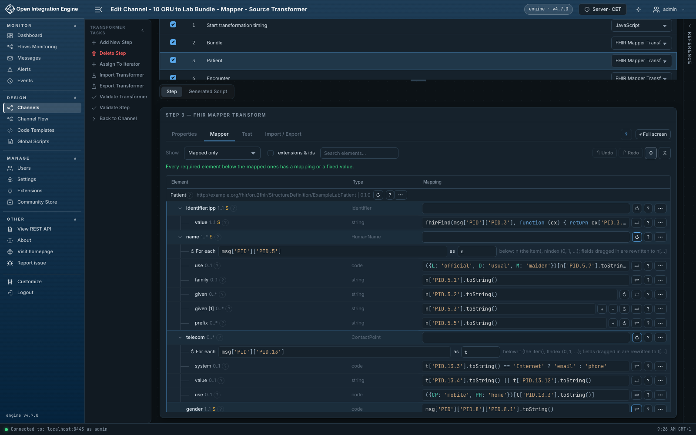
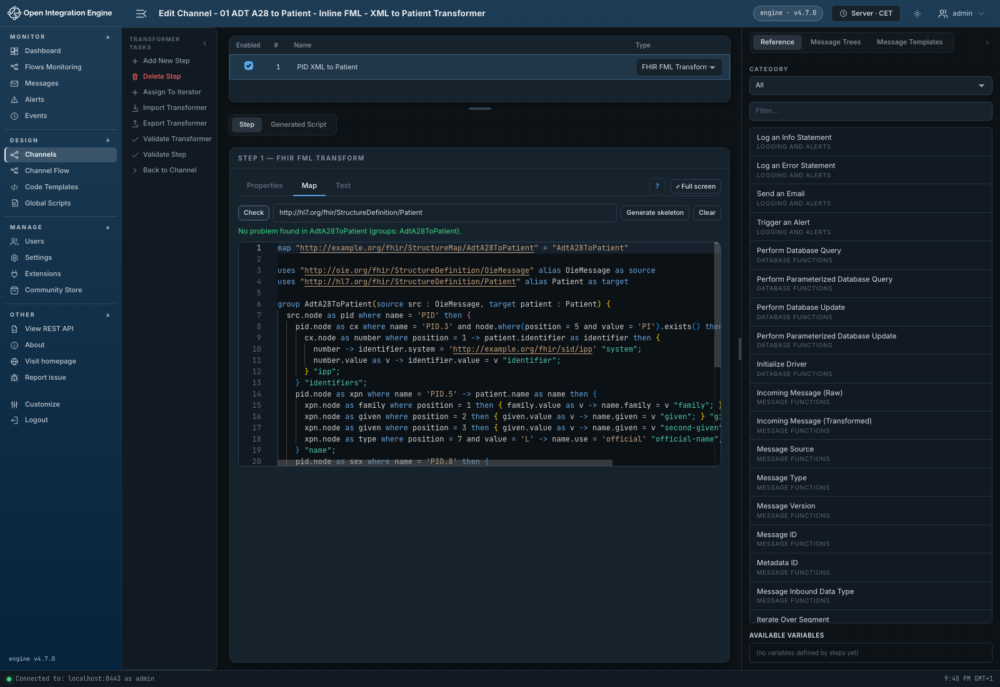

# OIE FHIR Mapper

> **Status: In development (pre-1.0).**

A plugin for [Open Integration Engine](https://github.com/OpenIntegrationEngine/engine)
(OIE 4.7, Web Admin 1.3). It builds FHIR resources and Bundles from business
messages.
It requires the [**FHIR Data Type**](https://github.com/matthydehoog/fhir-datatype-Eclipse-OIE)
plugin, version 1.6.2 ([release](https://github.com/matthydehoog/fhir-datatype-Eclipse-OIE/releases/tag/v1.6.2)).
OIE FHIR Mapper is a separate project, not part of FHIR Data Type: please report
bugs in [GitHub Issues](https://github.com/kazepoy/oie-fhir-mapper-plugin/issues)
and use [GitHub Discussions](https://github.com/kazepoy/oie-fhir-mapper-plugin/discussions)
for questions, feedback and ideas.

## Install

Prebuilt plugin archives (`fhir-mapper-<version>.zip`) are available on [GitHub Releases](https://github.com/kazepoy/oie-fhir-mapper-plugin/releases) and can be installed directly on an existing **OIE 4.7** server (with Web Support / Web Admin 1.3 and FHIR Data Type 1.6.2): download the zip, extract it into your OIE `extensions/` directory (or deploy it via OIE Administrator / `custom-extensions`), and restart OIE.

## Try it

The demo includes sample channels and test messages, making it a good way to evaluate the plugin before installing it on an existing OIE instance.

```sh
git clone https://github.com/kazepoy/oie-fhir-mapper-plugin.git
cd oie-fhir-mapper-plugin/demo
docker compose up -d --build
```

Administration: <https://localhost:8443/oie-webadmin/> (`admin` /
`admin`). See the [demo guide](doc/fr/demo/Demo.md) (in French).

The demo uses `demo/fhir-volume` for FHIR resources,
`demo/oie-init/data` for its configuration, groups, tags and 18 channels, and
`demo/term-server` for remote terminology.

## FHIR Mapper Transform

A transformer step that maps a message onto a FHIR profile: profile tree, slices,
expressions, conditions, iterations, translations, references between resources,
FHIR validation and per-rule diagnostics. Expressions are edited in Web Admin's code
editor with completion (mapper functions, iteration variables, sample paths,
references of other steps); sample messages and their expected results are saved
with the step.



## FHIR FML Transform

A second transformer step, next to the Mapper Transform: it runs an FML map
(StructureMap) on an inbound FHIR resource, a logical model (XML or JSON,
including HL7 v2 Strict Parser XML, described by a `StructureDefinition`), or a
generic OIE model (`OieMessage`), then validates and publishes the result. The
map is a file of the profile locations, or is written in the step itself, in an
editor with highlighting, completion, syntax check and skeleton
generation. It uses the FML engine of the HL7 core
that FHIR Data Type ships, with no extra library.



## Features

- **FHIR versions & profiles**: supports R4, R4B and R5 `StructureDefinition`s, base resources, Implementation Guide `.tgz` packages, slices, sub-slices, choice types `[x]`, profile/context extensions, primitive extensions (including repeated primitives) and profiled `contained` resources.
- **Graphical Mapper Transform**: JavaScript/E4X value expressions with Monaco completion, iterations (`each`), conditions, `ConceptMap` translations (local or remote `$translate` with fallback modes), modal element inspector (`?`) with per-rule notes and enable/disable toggles, undo/redo and branch duplication.
- **Multi-step Bundles & references**: declares named Bundles (`transaction`, `batch`, `collection`, `document`, `message`), shares a resource across multiple Bundles, and resolves typed cross-step references (`fhirRef`, `fhirRefs`, forward reservation).
- **FHIR FML Transform**: executes `StructureMap` or inline FML over inbound FHIR resources (`fhir`), logical XML/JSON models (`logical`, including HL7 v2 Strict Parser XML via `xml-name`), or the generic `OieMessage` envelope (`oie-message`), with syntax highlighting, completion, server `Check` and skeleton generation.
- **Testing, diff & diagnostics**: live server preview (single-step or full-transformer), saved step samples with expected-result comparison (UUID-normalized diff), per-rule error navigation (`Go to rule`), generated script inspection and execution traces (`fhirMapperTrace`, `FML_TRACE_*`).
- **Import / Export & documentation**: CSV and Markdown value tables (`key,expression,note`), standalone HTML/Markdown mapping documentation, and full-step JSON editing.
- **Shared contexts, i18n & RBAC**: server-wide **Settings › FHIR Mapper** contexts (FHIR version, packages, terminology server with `Authorization` expression, cache/timeout, validation policy), English/French UI, light/dark themes and five RBAC permissions.

## Documentation

Detailed documentation is in French:

- [Documentation hub](doc/README.md): French docs (`doc/fr/`) and [agent manual](doc/agent-manual/README.md)
- [Illustrated user manual](doc/fr/user-manual/README.md): Mapper Transform, FML and Settings, with feature-by-feature procedures and screenshots
- [Mapping format and execution](doc/fr/reference/Specification-mapping.md)
- [Demo](doc/fr/demo/Demo.md)

License: [Mozilla Public License 2.0](LICENSE).
