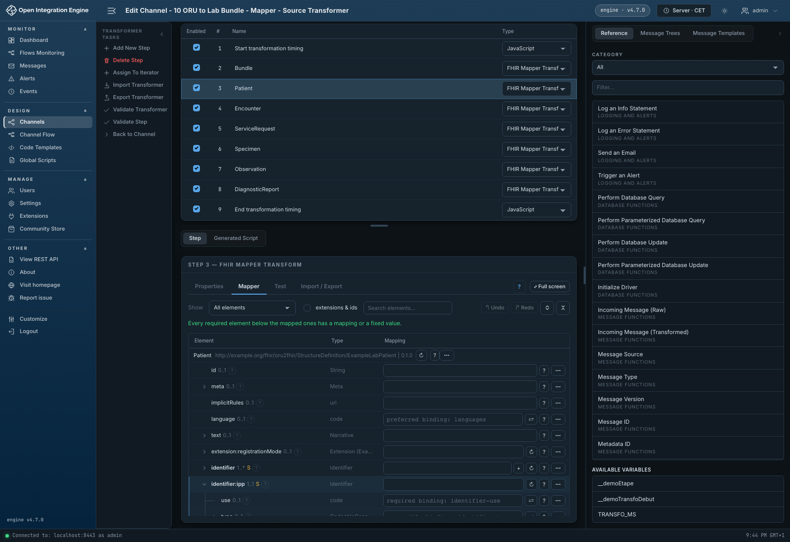

# Manuel utilisateur — OIE FHIR Mapper

Ce manuel présente l'utilisation complète du plugin **OIE FHIR Mapper** dans l'administration web d'Open Integration Engine (OIE 4.7, Web Admin 1.3) :

- **FHIR Mapper Transform** : éditeur graphique sur l'arbre d'un profil FHIR, règles JavaScript/E4X, assemblage multi-étapes de Bundles, jeux d'essai et trace par règle ;
- **FHIR FML Transform** : exécution et édition de transformations **FHIR Mapping Language** (`StructureMap` ou texte FML inline) sur des ressources FHIR, des modèles logiques ou le modèle générique `OieMessage` ;
- **Settings › FHIR Mapper** : contextes FHIR partagés entre les canaux (version FHIR, packages, serveur de terminologie, politique de validation et langue).

## Sommaire

| Besoin | Section |
|---|---|
| Réaliser un premier essai et choisir son transformeur | [Démarrage rapide](demarrage.md) |
| Configurer les contextes FHIR partagés, les packages, la terminologie et la langue | [Settings › FHIR Mapper](settings/README.md) |
| Mapper graphiquement un profil FHIR, construire des Bundles et tester les règles | [FHIR Mapper Transform](mapper-transform/README.md) |
| Configurer, écrire, vérifier et tester une transformation FML | [FHIR FML Transform](fml/README.md) |

## Prérequis et permissions

Le serveur OIE doit disposer du plugin **FHIR Mapper** et du plugin [**FHIR Data Type 1.6.1**](https://github.com/matthydehoog/fhir-datatype-Eclipse-OIE/releases/tag/v1.6.1). Les chemins de packages et de profils configurés dans l'interface sont des chemins du **serveur OIE** (ou de son conteneur Docker), et non du poste client.

Lorsque le contrôle d'accès par rôles (RBAC) est actif, cinq permissions gouvernent les fonctions du plugin :

| Action | Permission requise |
|---|---|
| Charger un profil, éditer et compiler un mapping graphique | `Edit FHIR mappings` |
| Exécuter un test dans **FHIR Mapper Transform** | `Test FHIR mapper steps` |
| Lister, éditer et vérifier (`Check`) une map FML | `Edit FHIR FML transforms` |
| Exécuter un test dans **FHIR FML Transform** | `Test FHIR FML transforms` |
| Modifier et enregistrer les contextes dans **Settings › FHIR Mapper** | `Manage FHIR mapper settings` |

## Cycle de sauvegarde et de déploiement

- **Édition d'un canal** : toute modification dans une étape **FHIR Mapper Transform** ou **FHIR FML Transform** s'inscrit dans le brouillon du canal ouvert. Cliquer sur **Save Changes** au niveau du canal, puis sur **Deploy Channel** pour appliquer le nouveau comportement aux messages traités.
- **Onglet Test** : exécute immédiatement la configuration en cours d'édition sur le serveur, sans avoir besoin d'enregistrer ni de redéployer le canal.
- **Settings › FHIR Mapper** : cliquer sur **Save** dans *FHIR Mapper Tasks* enregistre immédiatement les contextes sur le serveur. Les canaux déjà déployés qui référencent un contexte modifié doivent être **redéployés** pour prendre en compte ses nouveaux paramètres au runtime.

## Références techniques

Pour les spécifications détaillées du moteur et des formats :

- [Spécification du format et de l'exécution des mappings](../reference/Specification-mapping.md)
- [Référence de l'éditeur FHIR Mapper Transform](../reference/Mappeur-graphique.md)
- [Référence de l'étape FHIR FML Transform](../reference/Transformation-FML.md)
- [Format des traces d'exécution](../reference/Trace.md)
- [Guide de la démonstration Docker (17 canaux)](../demo/Demo.md)
