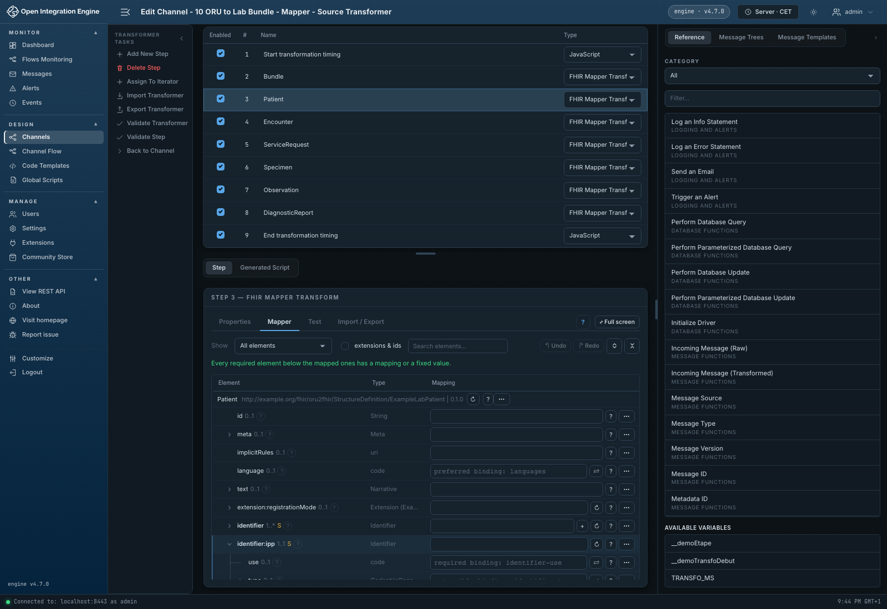
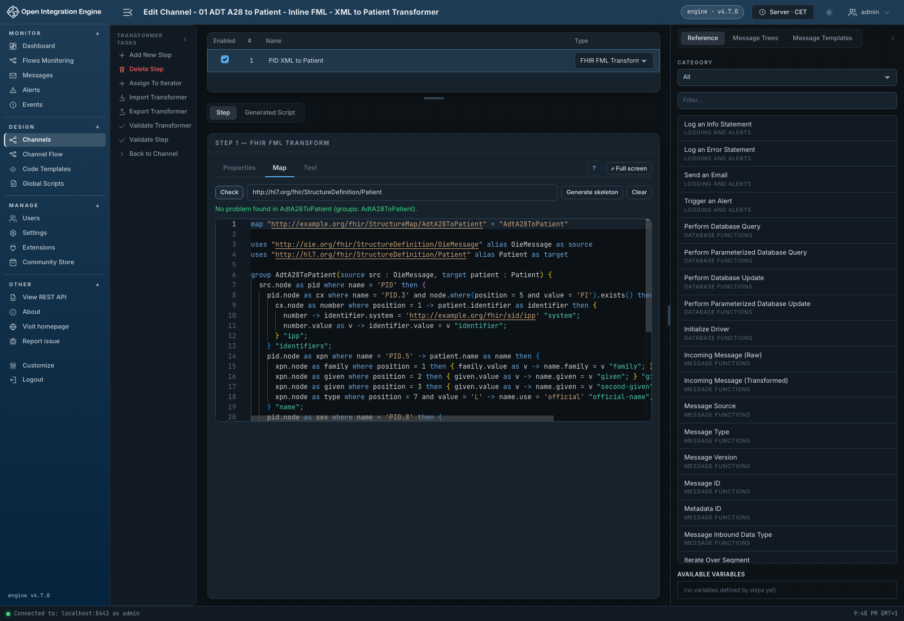

# Démarrage rapide

[Accueil du manuel](README.md) · [Settings](settings/README.md) · [Mapper Transform](mapper-transform/README.md) · [FML Transform](fml/README.md)

## Choisir entre FHIR Mapper Transform et FHIR FML Transform

Le plugin fournit deux types d'étapes de transformeur complémentaires :

| Critère | FHIR Mapper Transform | FHIR FML Transform |
|---|---|---|
| **Approche** | Arbre graphique guidé par le snapshot du profil FHIR cible | Langage déclaratif standard HL7 (**FHIR Mapping Language**) |
| **Expressions** | JavaScript / E4X directement sur le message OIE (`msg`) | Règles FML et expressions FHIRPath sur un modèle source typé ou `OieMessage` |
| **Assemblage de Bundles** | Multi-étapes : déclaration de Bundles nommés et rattachement de ressources avec `fhirRef('...')` | Monobloc : la map FML construit directement sa ressource ou son Bundle cible |
| **Jeux d'essai** | Exemples nommés enregistrés dans l'étape (`samples`), résultats attendus, diff côte à côte et **Run all** | Sample intégré à l'étape, aperçu du modèle source (**FML source**), résultat et validation |
| **Cas d'usage type** | Intégration rapide dans OIE à partir de HL7 v2, XML, CSV ou JSON métier | Transformations portables appuyées sur des Implementation Guides et des `StructureMap` |

## Parcourir une étape FHIR Mapper Transform existante

Dans la [démonstration](../demo/Demo.md) (<https://localhost:8443/oie-webadmin/>, `admin` / `admin`) :

1. Ouvrir **Channels**, sélectionner le canal **10 ORU to Lab Bundle - Mapper**, puis cliquer sur **Source › Edit Transformer**.
2. Replier si souhaité le panneau droit de référence (**Collapse the reference panel**) pour consacrer toute la largeur à l'étape.
3. Sélectionner l'étape **Patient** (de type **FHIR Mapper Transform**).
4. L'étape s'ouvre sur l'onglet **Mapper** : l'arbre présente les éléments du profil `ExampleLabPatient`, leurs cardinalités, slices (`identifier:ipp`), itérations (`↻`), conditions (`?`) et traductions (`⇄`).
5. Cliquer sur le bouton **`?`** d'un élément (par exemple `gender` ou `name`) pour ouvrir son **inspecteur modal** (définition FHIR, binding, règles, notes et cases d'activation).
6. Ouvrir l'onglet **Test**, choisir l'exemple **Minimal ORU** et cliquer sur **Run test** (ou **Run all** pour exécuter tous les jeux d'essai enregistrés).

## Parcourir une étape FHIR FML Transform existante

1. Dans **Channels**, ouvrir le canal **01 ADT A28 to Patient - Inline FML**, puis **Destination 1 › Edit Transformer**.
2. Sélectionner l'étape **Inline FML transformation** (de type **FHIR FML Transform**).
3. L'onglet **Properties** résume le contexte FHIR, le modèle source (**Generic OIE message**), le mode de la map et la destination du résultat.
4. L'onglet **Map** affiche le code FML embarqué dans l'étape avec coloration syntaxique ; cliquer sur **Check** pour vérifier la syntaxe et les dépendances sur le serveur.
5. Ouvrir l'onglet **Test** et cliquer sur **Run test** : parcourir **Sample**, **FML source** (l'arbre `OieMessage` construit à partir du message HL7 v2), **Result** (le `Patient` FHIR produit) et **Validation**.

## Créer une nouvelle étape dans un transformeur

1. Dans l'éditeur de transformeur (Source, Destination ou Response), cliquer sur **Add New Step**.
2. Dans la colonne **Type**, remplacer le type par défaut par **FHIR Mapper Transform** ou **FHIR FML Transform**.
3. Configurer l'onglet **Properties** :
   - pour un mapping graphique : suivre [Propriétés, profils, Bundles et sorties](mapper-transform/proprietes-et-bundles.md) ;
   - pour une transformation FML : suivre [Configurer une étape FML](fml/configurer.md).
4. Tester l'étape dans l'onglet **Test**, puis revenir au canal pour l'enregistrer (**Save Changes**) et le déployer (**Deploy Channel**).
