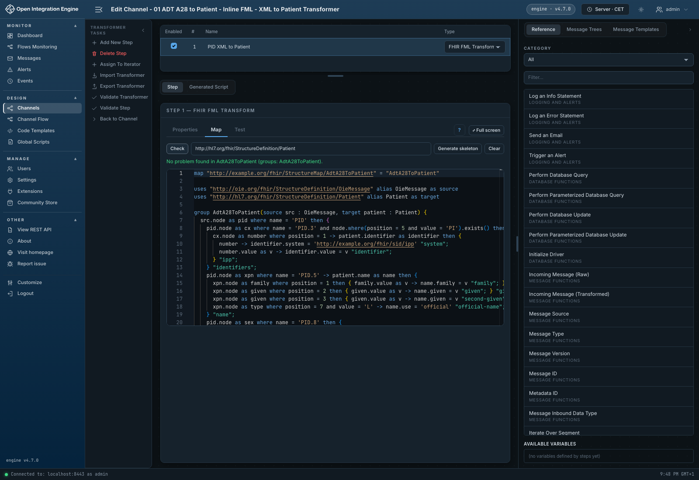

# FHIR FML Transform

[Accueil du manuel](../README.md) · [Démarrage](../demarrage.md)

L'étape **FHIR FML Transform** exécute une transformation écrite en **FHIR Mapping Language** (FML, ressource `StructureMap`) à l'aide du moteur FML du core HL7 fourni par **FHIR Data Type**.

Elle s'organise en trois onglets :

- **Properties** : parcours structuré en quatre étapes (**FHIR context**, **1 Source**, **2 Map**, **3 Destination**) pour choisir le contexte FHIR, le modèle source (**FHIR resource**, **Logical model** ou **Generic OIE message**), la map FML (fichier de contexte ou map inline) et la destination du résultat ;
- **Map** : éditeur de code FML intégré avec coloration syntaxique, complétion contextuelle, vérification serveur (**Check**), génération de squelette depuis un profil cible (**Start from an example**) et retour à la map fichier (**Clear**) ;
- **Test** : exécution interactive en quatre sous-onglets (**Sample**, **FML source**, **Result**, **Validation**), permettant de tester une entrée brute du canal (avec les options du Summary) ou une entrée déjà préparée (XML, JSON ou texte).

## Guides détaillés

1. [Configurer l'étape : contexte, modèle source, map et destination](configurer.md) : choisir entre contexte partagé et contexte local, sélectionner le modèle source, charger une map depuis un IG/dossier ou la copier vers l'éditeur inline, configurer la validation et la trace FML.
2. [Écrire et vérifier une map FML dans l'étape](editer-et-verifier.md) : éditer une map inline avec la complétion, générer un squelette à partir d'un profil cible et diagnostiquer les erreurs de syntaxe ou de dépendances (`uses`, `imports`) avec **Check**.
3. [Tester une transformation FML et inspecter le modèle source](tester.md) : exécuter la map sur un sample brut ou préparé, inspecter l'arbre reçu dans **FML source** (`OieMessage` ou modèle logique/FHIR) et contrôler le résultat ainsi que la validation FHIR.
