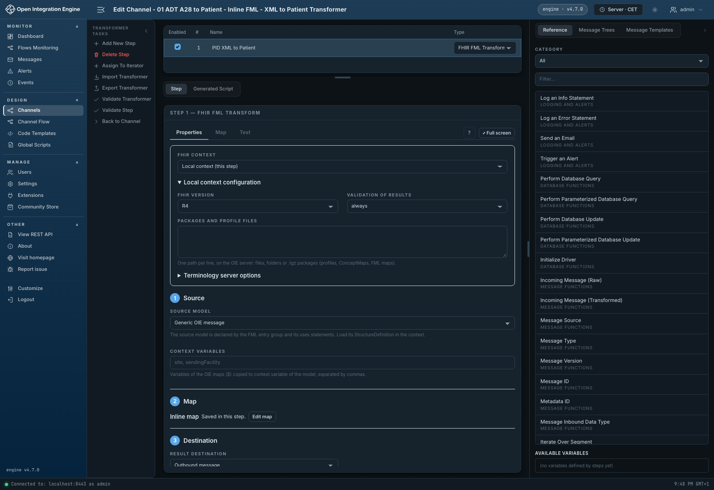

# Configurer l'étape : contexte, modèle source, map et destination

[Manuel](../README.md) · [FML Transform](README.md)

L'onglet **Properties** d'une étape **FHIR FML Transform** suit l'ordre d'exécution de la transformation : **FHIR context → 1 Source → 2 Map → 3 Destination**.



## 1. Contexte FHIR (`FHIR context`)

- **Contexte partagé (*Settings*)** : en sélectionnant un contexte défini dans [Settings › FHIR Mapper](../settings/README.md) (ex. `patient-r4`, `demo-labo`, `fr-core-2.2.0`), l'étape hérite de sa version FHIR, de ses packages, de son serveur de terminologie et de sa politique de validation par défaut. Cliquer sur **Context details** permet d'afficher ces paramètres en lecture seule.
- **Contexte local (`Local context (this step)`)** : permet de définir directement dans l'étape :
  - **FHIR version** (`R4`, `R4B` ou `R5`) ;
  - **Validation of results** (`always` ou `off`) ;
  - **Packages and profile files** (un chemin serveur par ligne : fichiers `.fml` / `.map`, `StructureMap` JSON/XML, profils `StructureDefinition`, `ConceptMap`, dossiers ou archives `.tgz`) ;
  - **Terminology server**, **Authorization**, **Cache (seconds)** et **Timeout (seconds)** pour résoudre `translate()` via `ConceptMap/$translate` lorsqu'une ConceptMap n'est pas purement locale.

## 2. Modèle source (`1 Source`)

Le champ **Source model** détermine la manière dont le message OIE est présenté au premier paramètre source du groupe d'entrée FML :

| Modèle source | Fonctionnement et cas d'usage |
|---|---|
| **FHIR resource** *(défaut)* | Le message entrant est une ressource FHIR JSON ou XML standard/profilée, parsée directement par le moteur HL7 (ex. canal **05 FHIR Patient - Normalize Identity**). |
| **Logical model** | Le message entrant est du XML ou JSON non FHIR décrit par une `StructureDefinition` logique choisie dans **Logical model (StructureDefinition)** (bouton **Load models** pour lister les modèles logiques du contexte) : modèle logique métier JSON (ex. canal **06 JSON Order to Dispatch**) ou XML HAPI du Strict Parser (ex. canal **04 HL7v2 PID to FR Core INS**). |
| **Generic OIE message** (`OieMessage`) | Convertit tout message OIE (XML HL7 v2 standard ou strict, XML de résultat SQL, CSV délimité, JSON ou texte) en une instance du modèle générique `https://openintegrationengine.org/fhir/StructureDefinition/OieMessage` composée de nœuds récursifs (`node`, `name`, `position`, `occurrence`, `value`, `attribute`, `context`). Idéal pour transformer un flux sans écrire de `StructureDefinition` source préalable (ex. canaux **01**, **02**, **03**, **07**, **08**, **11**, **17**). |

Lorsque **Generic OIE message** est sélectionné, le champ **Context variables** permet de lister des variables OIE séparées par des virgules (ex. `site, sendingFacility`) qui seront copiées dans `src.context.variable`. Pour une comparaison détaillée des représentations sources, voir [Données OIE, OieMessage et modèles sources FML](../../architecture/Representations-sources.md).

## 3. Choix de la map (`2 Map`)

Une étape peut exécuter soit une map chargée depuis les ressources du contexte (`mapUrl`), soit une map écrite directement dans l'étape (`mapSource`) :

- **Utiliser une map du contexte** :
  1. Cliquer sur **Load maps** pour lister les `StructureMap` et fichiers `.fml` / `.map` disponibles dans les emplacements du contexte (utiliser **Reload** après avoir modifié un fichier sur le serveur pour vider le cache mémoire).
  2. Sélectionner la map par son nom et son URL canonique.
  3. **Copy to inline map** permet de copier le code FML de la map sélectionnée dans l'onglet **Map** afin de l'adapter localement dans l'étape sans modifier le fichier serveur.
- **Utiliser une map inline** : dès que l'onglet **Map** contient du texte FML, un encadré indique *An inline map is defined in the Map tab and is stored in the step* ; cette map inline est alors exécutée en priorité (et peut importer d'autres maps du contexte via `imports`).

## 4. Destination, validation et trace (`3 Destination`)

- **Result destination** :
  - **Outbound message** : publie l'objet produit dans `tmp` s'il existe, sinon dans `msg` ;
  - **Channel Map variable** : publie le résultat JSON dans la variable de Channel Map indiquée (ex. `fmlImportedBundle` sur le canal 02).
- **Validate the result** :
  - hérite par défaut de la politique du contexte (`always` ou `off`) ;
  - cocher ou décocher la case surcharge cette politique pour cette étape uniquement (le bouton **Use context policy** supprime la surcharge) ;
  - décocher la validation lorsque la cible de la FML est un modèle logique métier non FHIR (comme dans le canal **06 JSON Order to Dispatch**).
- **Trace this step** : lorsqu'elle est cochée (après sauvegarde et redéploiement du canal), chaque exécution de l'étape enregistre un document JSON complet dans la variable `FML_TRACE_D<connectorId>_S<sequence>` de la Channel Map (entrée reçue, instance `fmlSource`, paramètres effectifs, sortie, diagnostics de validation, statut et durée en millisecondes).

## Sélection dynamique de la map et du modèle logique

Les champs **Map from the context** et **Logical model (StructureDefinition)** acceptent
une URL canonique fixe ou une référence complète à une variable OIE :

| Propriété | Exemple |
|---|---|
| Map | `${fmlMapUrl}` |
| Modèle logique source | `${fmlSourceModelUrl}` |

Dans le filtre source ou un step précédent, renseigner les variables pour
chaque message, par exemple :

```javascript
channelMap.put('fmlMapUrl', 'http://example.org/fhir/StructureMap/AdtA28');
channelMap.put('fmlSourceModelUrl', 'http://example.org/fhir/StructureDefinition/AdtA28');
```

La résolution utilise la recherche habituelle des variables OIE (`$(nom)`).
Les noms ne sont pas à ajouter à **Context variables**. Une variable absente
ou vide arrête le traitement avec une erreur qui indique son nom. Les maps et
modèles doivent être chargés dans le contexte de l’étape. Il n’y a pas de
contrôle supplémentaire de correspondance entre la map et le modèle source.

Une map inline reste prioritaire : `${fmlMapUrl}` n’est alors pas utilisée.
La variable du modèle logique reste applicable. Les variables contiennent des
URL canoniques, pas du texte FML ni des expressions JavaScript. Les deux URL
résolues sont visibles dans les traces lorsque **Trace this step** est activé.
