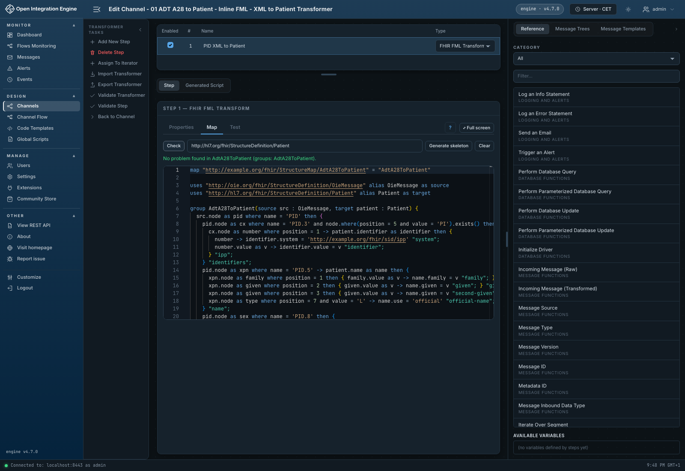

# Écrire et vérifier une map FML dans l'étape

[Manuel](../README.md) · [FML Transform](README.md)

L'onglet **Map** permet d'écrire ou de modifier une transformation FML directement dans l'étape (propriété `mapSource` sauvegardée avec le canal).

## 1. Éditer avec la coloration et la complétion FML

L'éditeur de code Monaco intégré prend en charge la grammaire FML :

- **Coloration syntaxique** des déclarations (`map`, `uses`, `imports`, `group`, `conceptmap`), des modes (`source`, `target`, `queried`, `produced`), des opérateurs (`->`, `then`, `where`, `check`, `log`), des littéraux et des commentaires ;
- **Complétion contextuelle (`Ctrl+Espace` ou `Alt+Espace` / `⌥Espace`)** :
  - mots-clés FML et fonctions de transformation (`create`, `copy`, `truncate`, `escape`, `cast`, `append`, `translate`, `reference`, `uuid`, `cc`, `c`, `qty`, `id`, `cp`) ;
  - fonctions FHIRPath usuelles (`where`, `exists`, `empty`, `first`, ` substring`, `startsWith`, `matches`, `toInteger`…) ;
  - alias déclarés par `uses`, noms de groupes, variables de règles et éléments des profils déjà chargés.
- **Full screen** étend l'éditeur à toute la page (`Échap` pour quitter).
- **Clear** efface le texte FML inline et redonne la main à la map fichier sélectionnée dans l'onglet **Properties**.

## 2. Générer un squelette à partir d'un profil cible (`Start from an example`)

Lorsque l'éditeur est vide ou en cliquant sur **Start from an example** :

1. Saisir ou choisir l'URL canonique du profil cible (ex. `http://hl7.org/fhir/StructureDefinition/Patient` ou un profil d'IG chargé dans le contexte).
2. Cliquer sur **Generate skeleton**.
3. L'éditeur génère automatiquement l'en-tête `map`, les déclarations `uses` source (`OieMessage`) et cible, le groupe principal et des commentaires `// TODO` pour chacun des éléments obligatoires du profil cible.

## 3. Vérifier la syntaxe et les dépendances (`Check`)

Cliquer sur **Check** envoie la map inline au serveur (`/api/extensions/fhir-fml/check`) :

1. Le serveur parse la syntaxe FML avec le moteur HL7 et vérifie son en-tête ainsi que ses groupes.
2. Il contrôle que chaque modèle déclaré dans `uses` et chaque map déclarée dans `imports` sont effectivement résolus dans les emplacements du contexte FHIR de l'étape.
3. En cas de succès, la barre affiche le statut vert `Valid: <NomDeLaMap> (N group(s))`.
4. En cas d'erreur de syntaxe ou de dépendance manquante, le message indique la ligne et la colonne exactes et souligne l'erreur dans l'éditeur Monaco.

> [!NOTE]
> **Check** valide la syntaxe FML et la présence des dépendances `uses` / `imports`. Pour vérifier l'exécution réelle des expressions FHIRPath sur un message et la conformité FHIR de la ressource produite, utiliser l'onglet [Test](tester.md).
