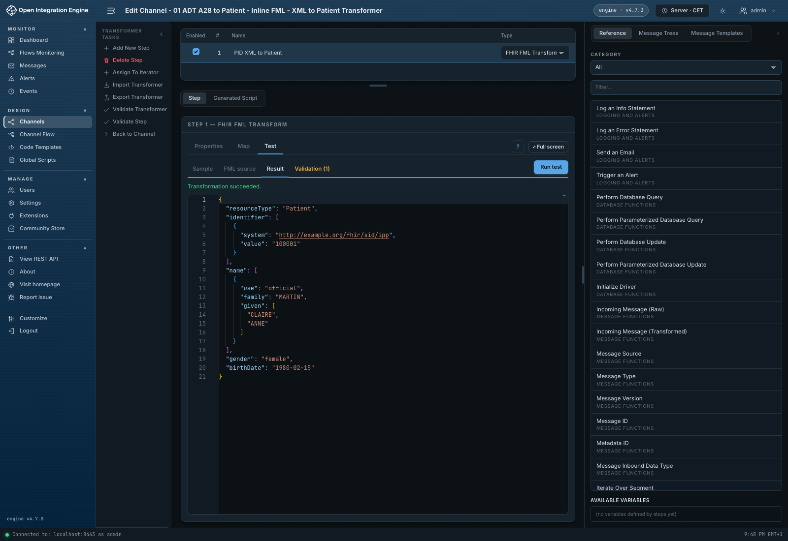
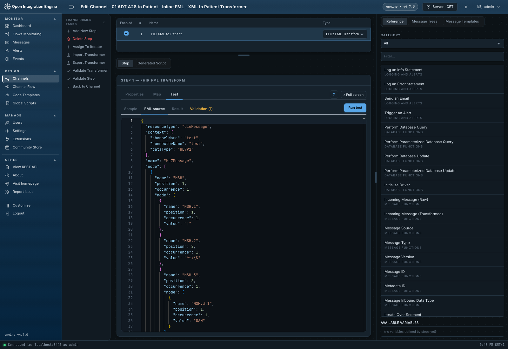

# Tester une transformation FML et inspecter le modèle source

[Manuel](../README.md) · [FML Transform](README.md)

L'onglet **Test** exécute la map FML sur le serveur avec le message d'essai fourni (permission requise : `Test FHIR FML transforms`, délai d'exécution limité à 10 secondes).

Il comporte quatre sous-onglets (**Sample**, **FML source**, **Result**, **Validation**) et le bouton **Run test**.

## 1. Choisir le format du sample : entrée du canal ou message préparé (`Sample`)

Dans le sous-onglet **Sample**, le sélecteur **Sample format** distingue deux modes de test :

| Mode | Comportement |
|---|---|
| **Entrée du transformeur (`Source input · HL7V2`, `Destination N input · ...`)** | Applique exactement le **datatype entrant et les propriétés de sérialisation** configurés dans le *Summary* du transformeur qui contient l'étape (par exemple HL7 v2 standard, HL7 v2 avec **Use Strict Parser** et **Strip Namespaces**, ou CSV avec séparateur personnalisé). Le bouton **`?`** à côté du sélecteur affiche le détail des options transmises au serveur. |
| **Entrée déjà préparée (`Prepared XML`, `Prepared JSON`, `Prepared text`)** | Transmet directement le contenu de l'éditeur au constructeur du modèle source FML, **sans réappliquer le parseur du Summary**. Utiliser ce mode lorsqu'une étape JavaScript précédente dans le transformeur a déjà converti le message en XML, en JSON ou en texte (comme dans les destinations 3, 4 et 5 du canal **03 HL7v2 to Patient - OieMessage**). |

La case **Format** permet d'indenter l'affichage du sample XML, JSON ou HL7 v2 sans altérer la charge envoyée au test.

## 2. Inspecter l'instance reçue par la map (`FML source`)

Après avoir cliqué sur **Run test**, ouvrir le sous-onglet **FML source** : il affiche la représentation JSON exacte de l'instance source remise au groupe d'entrée de la map FML.

- En mode **Generic OIE message** (`OieMessage`), on y observe directement la hiérarchie des nœuds `node`, avec leurs propriétés :
  - `name` : nom du segment (`PID`), du champ (`PID.5`), du composant (`PID.5.1`), de l'élément XML ou de la clé JSON ;
  - `position` : numéro de champ/composant ou rang parmi les frères (à partir de `1`) ;
  - `occurrence` : rang parmi les répétitions de même nom (à partir de `1`, utile pour les répétitions de `PID.3`, `PID.5` ou les segments `OBX`) ;
  - `value` : valeur textuelle d'un nœud feuille ;
  - `context` : métadonnées du message (`channelId`, `channelName`, `dataType`…) et variables demandées.
- En mode **FHIR resource / Logical model**, **FML source** affiche la ressource FHIR ou l'instance du modèle logique telle qu'elle a été lue par le parseur du core HL7 à partir de la `StructureDefinition` source.

## 3. Contrôler le résultat et la validation (`Result` & `Validation`)

- **Result** affiche la ressource ou le Bundle produit par la map FML, formaté en JSON.
- **Validation** affiche le verdict du validateur FHIR Data Type (`Valid.` ou la liste des erreurs et avertissements avec leur sévérité et leur chemin FHIR). Si le test produit des erreurs de validation, l'interface bascule automatiquement sur **Validation** et affiche un compteur sur l'onglet.
