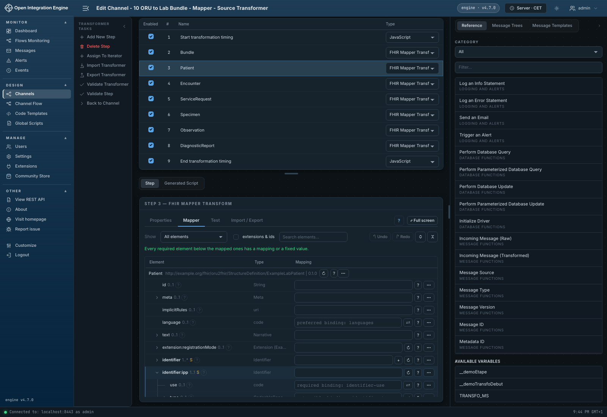

# FHIR Mapper Transform

[Accueil du manuel](../README.md) · [Démarrage](../demarrage.md)

L'étape **FHIR Mapper Transform** permet de construire des ressources et des Bundles FHIR à partir du message courant d'OIE (`msg`) en s'appuyant sur l'arbre du profil FHIR cible (`StructureDefinition`).

Elle s'organise en quatre onglets principaux :

- **Properties** : action (`Build a resource` ou `Create a Bundle`), contexte FHIR, profil cible, rattachement aux Bundles, destination du résultat, validation et trace ;
- **Mapper** : arbre du profil, expressions JavaScript/E4X, complétion contextuelle, types choix `[x]`, slices, extensions, itérations (`↻`), conditions (`?`), traductions (`⇄`) et inspecteur modal (`?`) ;
- **Test** : exécution sur le serveur en six sous-onglets (`Sample`, `Prepared message`, `Result`, `Validation`, `Trace`, `Generated script`), jeux d'essai enregistrés, aperçu multi-étapes et comparaison côte à côte ;
- **Import / Export** : import/export de tableaux de valeurs CSV et Markdown, export documentaire Markdown/HTML et édition JSON complète de l'étape.

## Guides détaillés

1. [Propriétés, profils, Bundles et sorties](proprietes-et-bundles.md) : configurer une ressource ou un Bundle, charger un profil, partager une ressource entre plusieurs Bundles, utiliser `fhirRef('...')` et choisir la validation.
2. [Studio de mapping : arbre, expressions, règles et inspecteur](studio-et-regles.md) : naviguer dans l'arbre, écrire des expressions avec la complétion Monaco, configurer les slices, types choix, extensions, itérations, conditions, traductions, notes et activations via l'inspecteur modal (`?`).
3. [Tests, jeux d'essai, aperçu multi-étapes et traces](tests.md) : tester une étape isolée ou tout le transformeur, enregistrer des exemples et leurs résultats attendus, diagnostiquer une règle en erreur (**Go to rule**) et analyser les traces d'exécution.
4. [Import / Export : tableaux, documentation et JSON](import-export.md) : modifier les expressions en tableau CSV/Markdown, générer la documentation HTML/Markdown et éditer l'étape en JSON.
