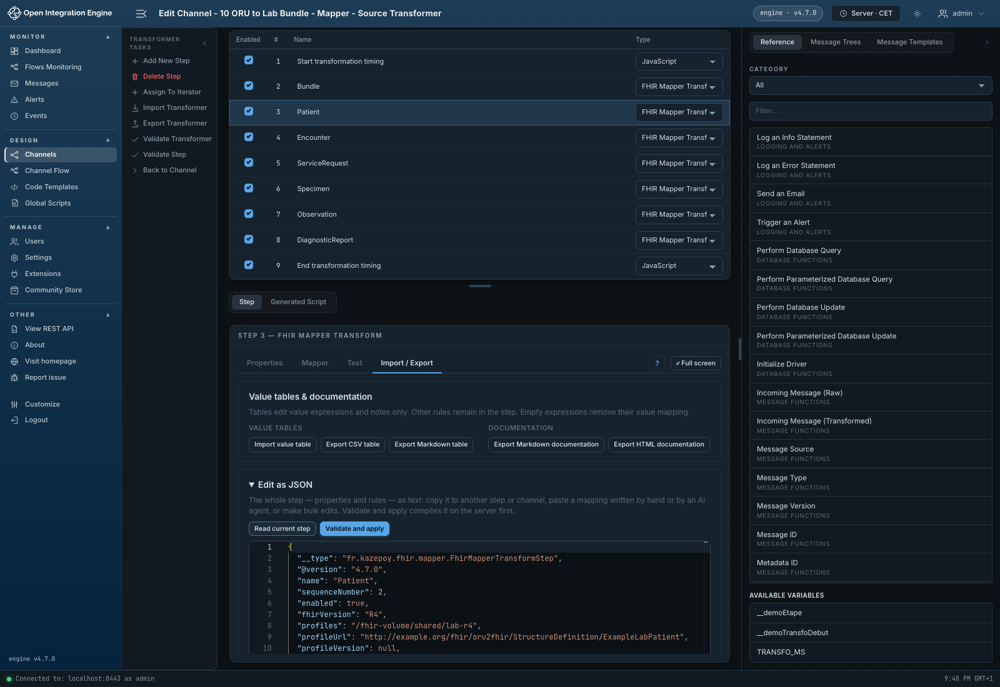

# Import / Export : tableaux, documentation et JSON

[Manuel](../README.md) · [Mapper Transform](README.md)

L'onglet **Import / Export** regroupe les outils d'échange par tableaux, de génération documentaire et d'édition JSON complète de l'étape.



## 1. Exporter et importer des tableaux de valeurs (CSV / Markdown)

La section **Value tables & documentation** permet d'exporter ou d'importer les règles de valeur sous forme d'un tableau à trois colonnes (`key`, `expression`, `note`) :

```csv
key,expression,note
Patient.active,true,Patient actif
Patient.gender,"msg['PID']['PID.8']['PID.8.1'].toString()",Code sexe HL7
```

- **Export CSV table** / **Export Markdown table** : télécharge toutes les expressions de valeur de l'étape et leurs notes au format `.csv` ou `.md`.
- **Import value table** : charge un fichier `.csv` ou `.md` modifié :
  - toutes les clés cibles sont vérifiées contre l'arbre du profil chargé avant toute modification (une clé inconnue, un doublon ou un type choix `[x]` non résolu rejette l'import en bloc sans altérer l'étape) ;
  - une expression vide supprime la règle de valeur correspondante ;
  - les conditions, itérations, traductions et états d'activation existants sont préservés ;
  - un clic sur **Undo** dans l'onglet **Mapper** permet d'annuler l'intégralité de l'import en une seule opération.

## 2. Exporter la documentation du mapping (Markdown / HTML)

- **Export Markdown documentation** : génère un document Markdown complet décrivant le contexte, le profil cible, les cibles de Bundles et le tableau détaillé de toutes les règles (valeurs, itérations, conditions, valeurs fixes, traductions ConceptMap, notes et état activé/désactivé).
- **Export HTML documentation** : génère une page HTML autonome, prête à être consultée dans un navigateur ou archivée avec la documentation projet.

## 3. Éditer l'étape complète en JSON (`Edit as JSON`)

La carte **Edit as JSON** permet d'inspecter, sauvegarder ou remplacer la définition JSON complète de l'étape :

1. Cliquer sur **Read current step** pour charger l'état courant de l'étape dans l'éditeur JSON.
2. Modifier le JSON ou coller la définition d'une étape existante (les propriétés `mappings`, `bundleTargets` et `samples` sont des chaînes contenant du JSON sérialisé, conformément au [contrat de l'étape](../../reference/Specification-mapping.md)).
3. Cliquer sur **Validate and apply** : le serveur contrôle la structure, vérifie la compilation JavaScript du mapping et, s'il n'y a aucune erreur, met à jour l'étape dans l'éditeur (en conservant son `sequenceNumber` et son état `enabled` dans le transformeur).
