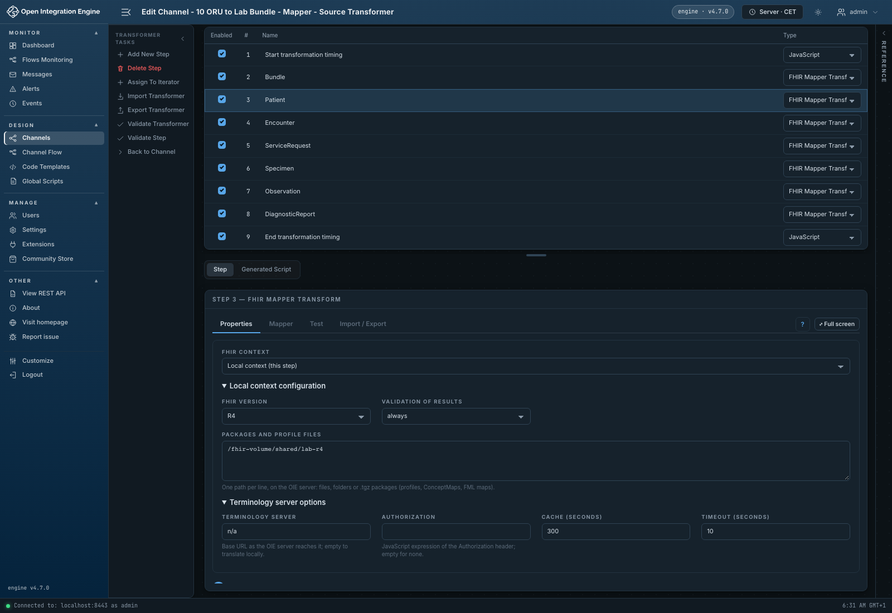
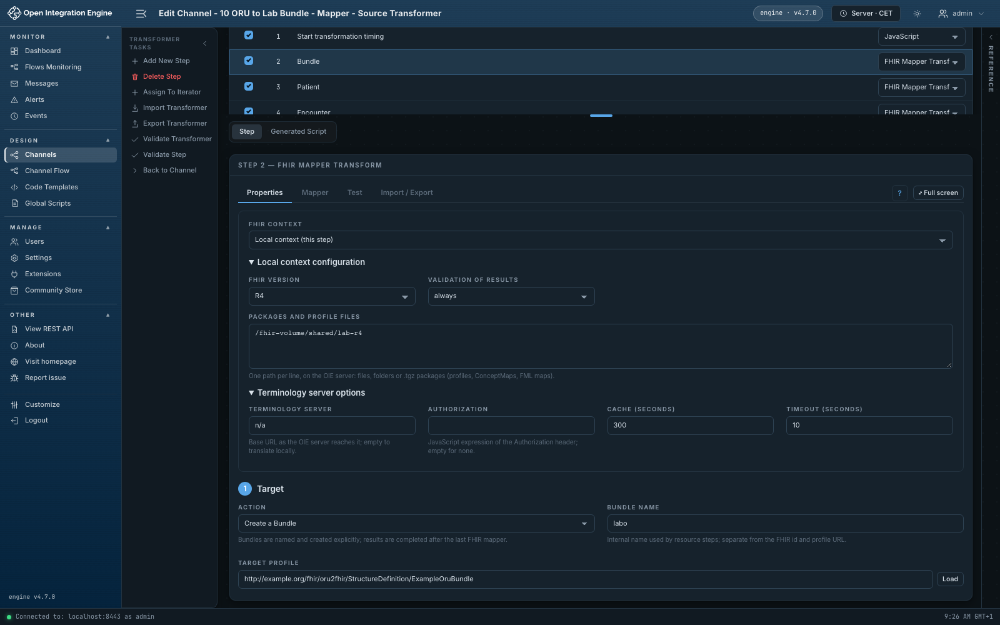

# Propriétés, profils, Bundles et sorties

[Manuel](../README.md) · [Mapper Transform](README.md)

Une nouvelle étape **FHIR Mapper Transform** s'ouvre automatiquement sur l'onglet **Properties** (une étape qui contient déjà des règles s'ouvre sur **Mapper**).



## 1. Choisir l'action : ressource ou Bundle

Le champ **Action** détermine le rôle de l'étape dans le transformeur :

| Action | Rôle |
|---|---|
| **Build a resource** | Construit une ressource FHIR (ex. `Patient`, `Observation`, `Encounter`) selon un profil cible. Elle peut être publiée seule ou ajoutée à un ou plusieurs Bundles créés plus haut dans le même transformeur. |
| **Create a Bundle** | Déclare un Bundle nommé (ex. `labo-transaction` ou `labo-document`), son type (`transaction`, `batch`, `collection`, `document`, `message`), son profil d'en-tête et sa destination finale. Les entrées (`Bundle.entry`) sont alimentées par les étapes **Build a resource** suivantes. |

## 2. Configurer le contexte FHIR et charger le profil cible

1. Dans **FHIR context**, sélectionner un contexte partagé défini dans [Settings › FHIR Mapper](../settings/README.md) (ex. `demo-labo`, `external-terminology`), ou laisser **No context (configure on this step)** pour renseigner localement **FHIR Version**, **Profile Packages** (chemins serveur séparés par `;`) et **Terminology Server**.
2. Dans **Target Profile**, saisir l'URL canonique du profil (ou le nom d'une ressource de base comme `Patient`), ou cliquer sur **List profiles** pour choisir un profil parmi ceux trouvés dans les packages du contexte.
3. Cliquer sur **Load** : le serveur relit le profil et ses types pour construire l’arbre dans l’onglet **Mapper**. Si un type nécessaire à une règle ne se charge pas, les règles existantes sont conservées et l’édition du mapping reste bloquée. Cliquer de nouveau sur **Load** pour réessayer.

> [!TIP]
> Changer de profil sur une étape déjà mappée conserve toutes les règles dont les chemins existent dans le nouveau profil et signale les éventuels éléments absents.

## 3. Déclarer et alimenter un ou plusieurs Bundles

Dans un transformeur multi-étapes (comme les canaux **10 ORU to Lab Bundle - Mapper** et **12 ORU to Two Lab Bundles - Mapper**) :

1. Placer d'abord une ou plusieurs étapes **Create a Bundle** en leur donnant un **Bundle Name** interne unique (ex. `labo-transaction`, `labo-document`) et leur **Result destination**.
2. Dans chaque étape **Build a resource** suivante, cocher dans **Add to Bundles** le ou les Bundles auxquels ajouter la ressource :
   - la ressource est construite **une seule fois** (avec le même `fullUrl` en `urn:uuid:...`) puis insérée dans chaque Bundle coché ;
   - pour un Bundle de type `transaction` ou `batch`, renseigner **Method** (`POST`, `PUT`, `DELETE`…), **Request URL** et, pour un `POST` conditionnel, l'expression **If-None-Exist**.



## 4. Référencer une ressource depuis une autre étape (`fhirRef`)

1. Sur l'étape qui produit la ressource cible (ex. `Patient` ou `Specimen`), renseigner une expression JavaScript dans **Reference Name**, par exemple `'patient'` ou, pour une ressource itérée à la racine, `'spm-' + hl7Ordinal(hl7Preceding(spm, 'OBR', []))`.
2. Dans l'étape qui doit référencer cette ressource (ex. `Observation.subject.reference`), utiliser la fonction du runtime :

```javascript
fhirRef('patient')
```

- `fhirRef(name, index, reserve)` retourne le `fullUrl` (`urn:uuid:...`) de l'entrée correspondante dans les Bundles sélectionnés (`index` vaut `0` par défaut).
- Passer `reserve = true` (`fhirRef('laboratoire', 0, true)`) permet de référencer une ressource construite par une étape située **plus bas** dans le transformeur : l'identité est réservée à l'avance et contrôlée lors de la finalisation du Bundle.
- La complétion Monaco (`⌥Espace` / `Ctrl+Espace`) propose automatiquement `fhirRef('...')` pour tous les noms de référence déclarés dans les autres étapes du transformeur.

## 5. Destination du résultat, validation et trace

Sur une étape **Create a Bundle** ou une étape **Build a resource** autonome (qui n'est ajoutée à aucun Bundle) :

- **Result destination** :
  - **Outbound message** : publie le JSON FHIR dans le message sortant du transformeur (`tmp` s'il existe, sinon `msg`) ;
  - **Channel map variable** : publie le JSON FHIR dans la variable de Channel Map indiquée (ex. `bundleDocument`).
- **Validate FHIR output** :
  - **as the context says** : suit la politique du contexte FHIR sélectionné ;
  - **always** : valide systématiquement le résultat final contre le profil cible ;
  - **off** : désactive la validation FHIR du résultat par le mappeur.
- **Options de métadonnées et de suivi** :
  - **Add the profile to meta.profile** : inscrit la canonique du profil cible dans `meta.profile` ;
  - **Set meta.lastUpdated** : renseigne `meta.lastUpdated` à l'exécution ;
  - **Trace processed messages** (et **Include scalar values**) : enregistre la trace détaillée de l'étape dans le `connectorMap` de chaque message traité par le canal déployé (`fhirMapperTrace`).
