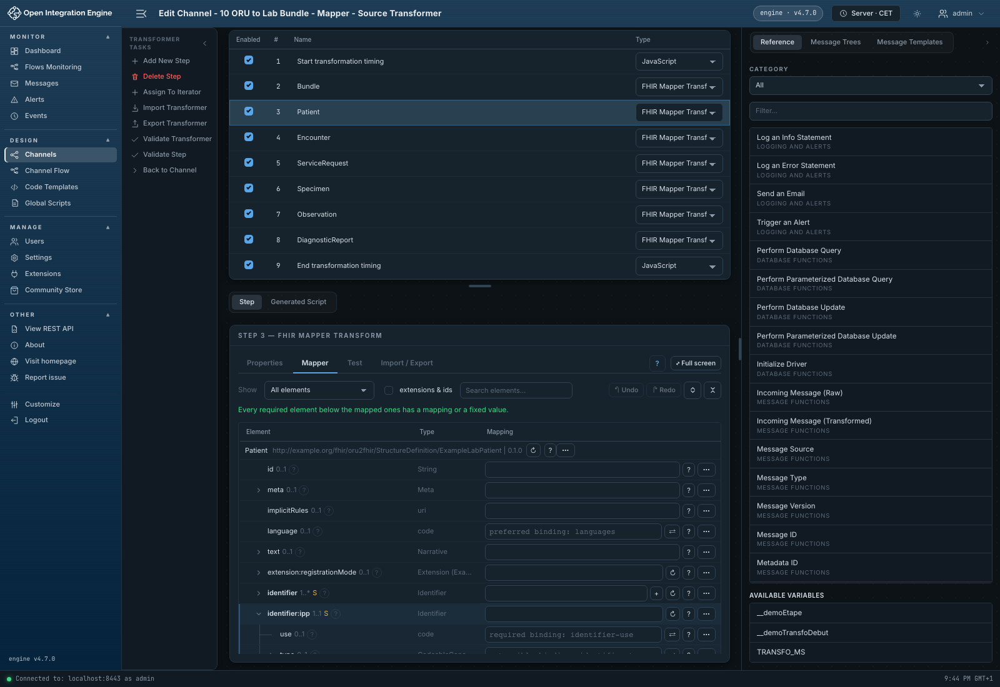
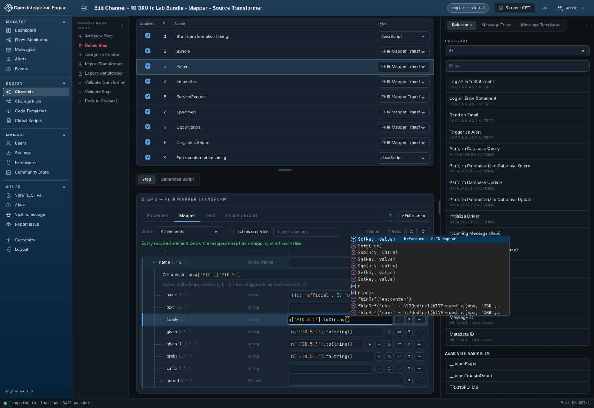
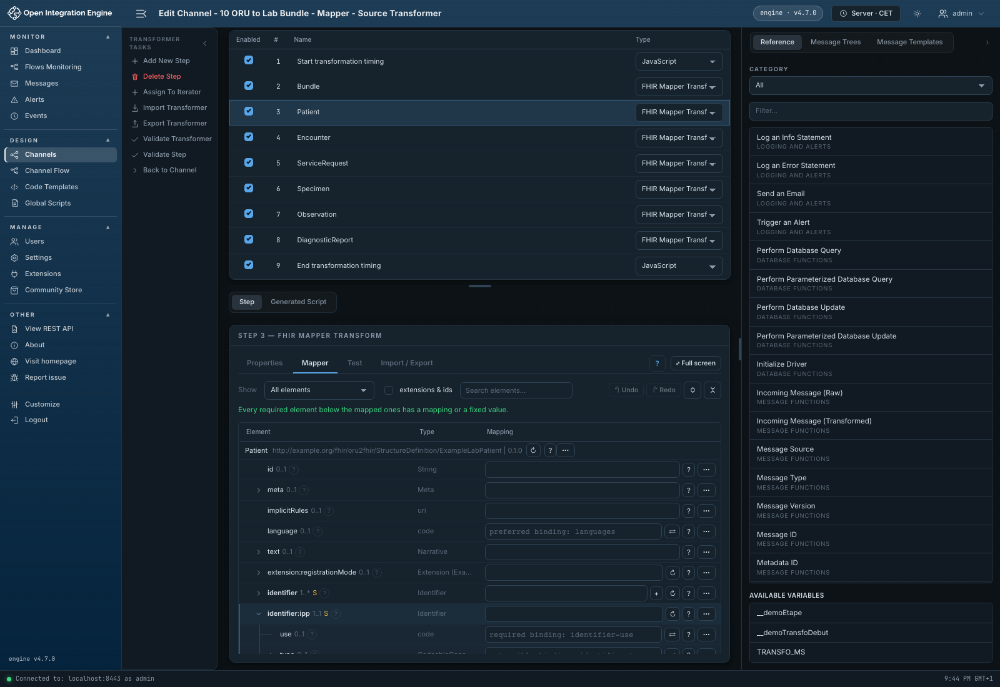
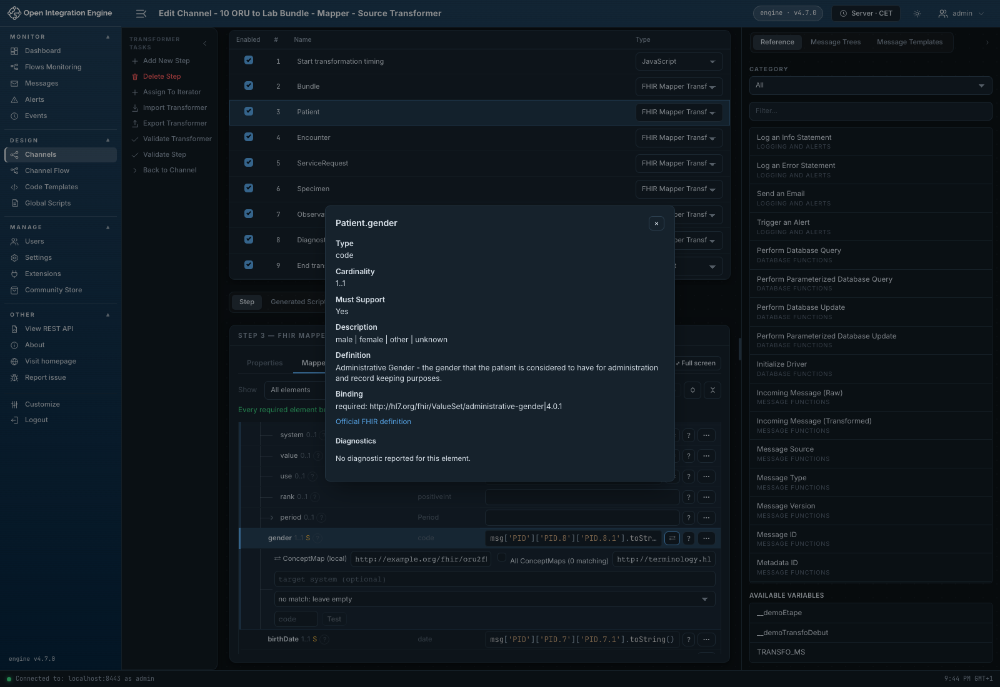

# Studio de mapping : arbre, expressions, règles et inspecteur

[Manuel](../README.md) · [Mapper Transform](README.md)

L'onglet **Mapper** présente l'arbre du profil cible et concentre toute la saisie des règles. Le bouton **Full screen** en haut à droite étend l'éditeur à toute la fenêtre de Web Admin (`Échap` ou **Exit full screen** pour quitter).



## 1. Parcourir et filtrer l'arbre du profil

La barre d'outils reste fixe en haut de l'arbre pendant le défilement :

| Contrôle | Effet |
|---|---|
| **Search elements** | Filtre l'arbre par nom ou chemin FHIR et déplie automatiquement les branches correspondantes. |
| **Show: all / required & S / mapped** | Affiche tous les éléments, uniquement les éléments obligatoires (`min >= 1`) et Must Support (`S`), ou uniquement les éléments mappés. |
| **extensions & ids** | Affiche ou masque les éléments techniques (`id`, `extension`, `modifierExtension`). |
| **Expand mapped / Collapse all** | Déplie toutes les branches contenant au moins une règle ou replie tout l'arbre. |
| **Undo / Redo** | Annule ou rétablit les modifications de règles, notes, activations, duplications et imports. |
| **Indicateur `N/M required`** | Indique en temps réel le nombre d'éléments obligatoires couverts à la racine. |

Raccourcis clavier dans l'arbre :
- `Alt+↓` / `Alt+↑` : passer au champ d'expression suivant ou précédent ;
- `Alt+→` / `Alt+←` : déplier ou replier la branche courante ;
- `Maj+F10` ou clic sur **`⋯`** (ou clic droit sur le nom) : ouvrir le menu contextuel de la ligne ;
- clic sur **`?`** : ouvrir l'**inspecteur modal** de l'élément.

## 2. Écrire des expressions JavaScript et utiliser la complétion

Cliquer dans la colonne **Mapping** d'un élément active l'éditeur de code Monaco sur une ligne :

```javascript
msg['PID']['PID.7']['PID.7.1'].toString()
```

Appuyer sur **`Alt+Espace`** (`⌥Espace` sur macOS) ou **`Ctrl+Espace`** ouvre l'aide à la complétion contextuelle :

1. **Variables d'itération** englobantes (ex. `n`, `nIndex`) ;
2. **Codes du ValueSet** lorsque l'élément possède un binding FHIR (ex. `'female'`, `'male'`, `'other'`, `'unknown'` sur `Patient.gender`) ;
3. **Références aux autres étapes** du transformeur (`fhirRef('patient')`) ;
4. **Chemins du message exemple** configuré dans l'onglet **Test**, automatiquement réécrits vers la variable d'itération la plus proche ;
5. **Fonctions du runtime** : `fhirRef`, `fhirRefs`, `fhirFind`, `fhirFilter`, `fhirUuid`, `hl7Following`, `hl7Preceding`, `hl7Ordinal` ;
6. **Modèles de garde** pour sécuriser les accès aux champs facultatifs.



> [!NOTE]
> Lorsque le panneau droit de Web Admin est déplié, vous pouvez également glisser-déposer un champ depuis **Message Trees** directement dans l'expression en cours d'édition.

## 3. Types choix `[x]`, slices, valeurs fixes et extensions

- **Types choix (`[x]`)** : déplier un élément polymorphe (ex. `deceased[x]` ou `value[x]`) pour voir ses branches typées (`valueQuantity`, `valueString`, `valueCodeableConcept`…) et mapper directement la branche correspondant au type voulu.
- **Slices et valeurs fixes** : les slices déclarées par le profil apparaissent sous la forme `identifier:ipp`. Mapper un sous-élément de la slice (ex. `identifier:ipp.value`) génère automatiquement les constantes et discriminants (`fixed` / `pattern`, comme `identifier:ipp.system`) requis par le profil.
- **Extensions** :
  - ouvrir l'inspecteur modal (**`?`**) de l'élément porteur (ou de la racine `Patient`) ;
  - **Profile extension** permet de révéler et déplier une slice d'extension déclarée dans le profil (son `url` fixe est ajoutée automatiquement) ;
  - **List context extensions** charge les `StructureDefinition` d'extensions du contexte pour ajouter une extension par son URL canonique sur une occurrence générique de `extension` ;
  - les extensions sous un champ primitif (y compris les primitives répétées comme `Patient.name.given`) sont automatiquement sérialisées dans la propriété compagnon `_field` (`_given`) alignée par indice.

## 4. Répétitions (`↻`), conditions (`?`) et traductions (`⇄`)

Les boutons situés à droite de chaque ligne permettent d'enrichir l'élément :

| Bouton | Règle ajoutée | Fonctionnement |
|---|---|---|
| **`+` / `−`** | Occurrence explicite | Ajoute ou supprime une occurrence statique (`[0]`, `[1]`…) d'un élément répétable, ou **Duplicate branch** depuis le menu `⋯` pour dupliquer toute une branche mappée non itérée. |
| **`↻`** | Itération (`each`) | Répète l'élément (ou la ressource entière si appliquée à la racine) pour chaque élément de la liste retournée par l'expression (ex. `msg['PID']['PID.5']` avec la variable `n`). L'indice courant est exposé dans `<variable>Index` (`nIndex`). |
| **`?` (condition via menu `⋯`)** | Condition (`Only if`) | N'exécute l'élément et ses descendants que si l'expression booléenne est vraie (ex. `n['PID.5.1'].toString() != ''`). Sur un élément itéré, la condition est évaluée pour chaque item. |
| **`⇄`** | Traduction (`translate`) | Traduit le code produit par l'expression à l'aide d'une **ConceptMap** locale ou du serveur de terminologie distant (`Source system`, `Target system`, comportement **If unmapped** : `leave empty`, `keep the source code`, `fixed value`, `expression`, `error`, et bouton **Test** immédiat sur un code d'essai). |



## 5. Inspecteur modal (`?`), notes et activation des règles

Cliquer sur le bouton **`?`** à gauche du menu `⋯` d'une ligne (ou sur le bouton **`?`** de la ligne racine) ouvre la fenêtre modale **Element inspector** :



L'inspecteur modal regroupe :
1. **Les métadonnées FHIR du profil** : chemin complet, types permis, cardinalité, badge Must Support, description, définition, binding ValueSet, contraintes `fixed`/`pattern` et lien **Official FHIR definition** ;
2. **Les diagnostics éventuels** rattachés à cet élément lors du dernier test ou de la dernière compilation ;
3. **Le sélecteur d'extensions** (**Profile extension** et **List context extensions**) lorsque l'élément accepte des extensions ;
4. **L'édition complète des règles de l'élément** :
   - champ **Expression** principal ;
   - cartes de chaque règle active sur l'élément (**Value**, **Condition**, **Iteration**, **Translation**, **Fixed value**) ;
   - **case d'activation** (`Rule enabled`) permettant de désactiver temporairement une règle (valeur, condition ou boucle) sans perdre son expression ;
   - champ **Note** pour documenter le rôle métier de chaque règle (les notes sont conservées dans le canal et reprises dans l'export documentaire Markdown/HTML).

Appuyer sur **`Échap`** ou cliquer sur **Close** referme la modale et restitue le focus au bouton **`?`** d'origine.
