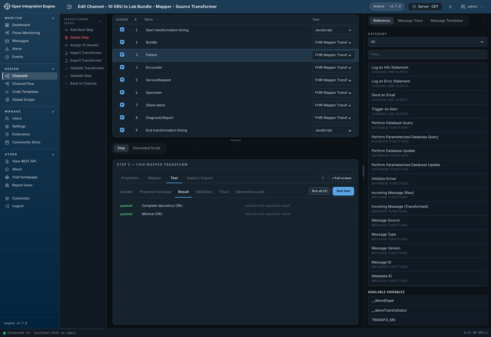
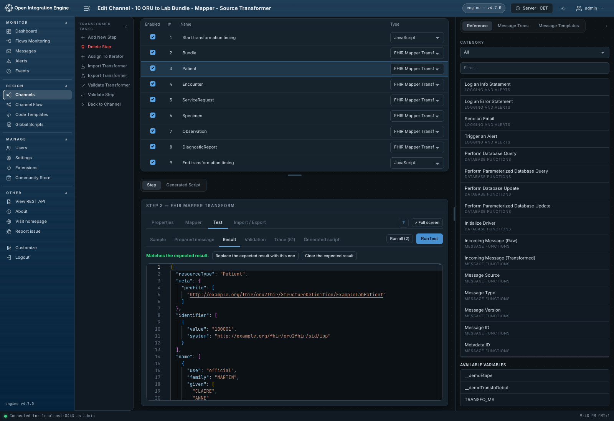
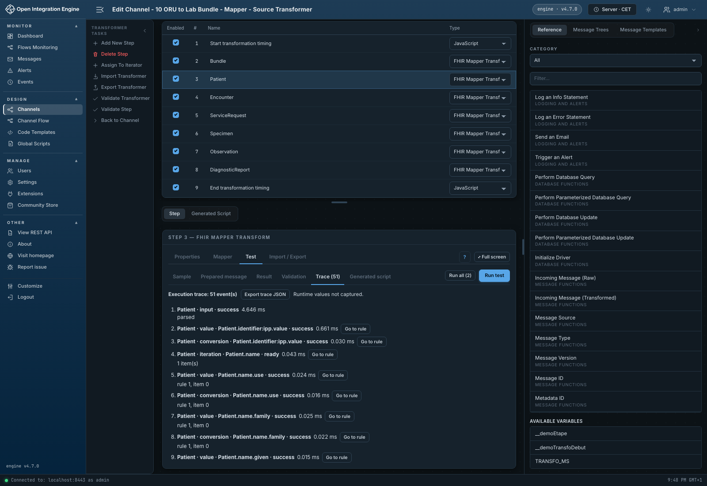

# Tests, jeux d'essai, aperçu multi-étapes et traces

[Manuel](../README.md) · [Mapper Transform](README.md)

L'onglet **Test** exécute le mapping sur le serveur OIE sans avoir à enregistrer ni déployer le canal (permission requise : `Test FHIR mapper steps`, délai d'exécution plafonné à 10 secondes).

Il comporte six sous-onglets (**Sample**, **Prepared message**, **Result**, **Validation**, **Trace**, **Generated script**) ainsi que les actions **Run all** et **Run test**.

## 1. Configurer l'exemple et choisir le périmètre d'aperçu (`Sample`)

Dans le sous-onglet **Sample** :

- **Data type** : format du message d'entrée (`HL7V2`, `XML`, `JSON` ou `RAW`).
- **Saved samples** : permet de sélectionner un jeu d'essai enregistré avec l'étape ou l'exemple de travail du navigateur (*Unsaved browser sample*).
  - **Save as sample** enregistre le message courant et son périmètre dans l'étape (propriété `samples` sauvegardée avec le canal) ;
  - **Delete sample** supprime le jeu d'essai sélectionné ;
  - **Run all** exécute séquentiellement tous les jeux d'essai enregistrés dans l'étape et affiche un tableau récapitulatif (`passed` / `failed`).
- **Preview scope** :
  - **This step only** : exécute uniquement l'étape courante en simulant les références `fhirRef('...')` ;
  - **Mapper Transform steps of this transformer** : exécute dans l'ordre toutes les étapes **FHIR Mapper Transform** actives du transformeur courant, résout les vraies références entre ressources et assemble les Bundles finaux ainsi que les variables de Channel Map publiées.
- **Format** : indente visuellement le message HL7 v2, XML ou JSON dans l'éditeur sans modifier la charge envoyée au serveur.
- **Trace** : active la capture des événements d'exécution par règle pour ce test (avec option **Include scalar values** et plafond **Max events** de 1 à 1 000).

## 2. Lire le résultat, les variables et la comparaison (`Result` & `Validation`)

Après un clic sur **Run test** :

- Le sous-onglet **Prepared message** montre la représentation sérialisée effectivement reçue par le runtime du mappeur (par exemple l'arbre XML produit par OIE à partir d'un message HL7 v2).
- Le sous-onglet **Result** affiche le JSON FHIR produit :
  - cliquer sur **Use this result as expected** enregistre ce JSON comme résultat attendu du jeu d'essai courant ;
  - lors des exécutions suivantes, le mappeur compare la sortie à l'attendu (en normalisant l'ordre des clés, `meta.lastUpdated` et les `urn:uuid:` tout en vérifiant la cohérence des références) et ouvre une vue **côte à côte** en cas d'écart ;
  - en mode **aperçu multi-étapes**, **Result** permet aussi d'inspecter les ressources intermédiaires produites par chaque étape (**Produced resources by step**) et les variables de Channel Map (**Published channel variables**, comme `bundleDocument`).
- Le sous-onglet **Validation** liste les résultats du validateur HAPI / FHIR Data Type (`fatal`, `error`, `warning`, `information`) avec leur emplacement FHIR.

## 3. Diagnostiquer une erreur et analyser la trace (`Trace` & `Generated script`)

- **Diagnostic par règle et bouton `Go to rule`** : lorsqu'une expression lève une exception (`TypeError`, erreur de conversion booléenne/numérique, traduction manquante en mode `error`…), la bannière d'erreur indique l'étape, la phase, le chemin FHIR et l'expression fautive. Cliquer sur **Go to rule** bascule automatiquement sur l'onglet **Mapper**, déplie la branche concernée et place le focus sur la règle en erreur.
- **Sous-onglet `Trace`** : lorsque **Trace** a été coché avant **Run test**, ce sous-onglet détaille chaque phase exécutée (`input`, `iteration`, `condition`, `value`, `translation`, `conversion`, `fixed`, `validation`) avec sa durée, son statut (`success`, `passed`, `skipped`, `absent`…) et un bouton **Go to rule** sur chaque événement. **Export trace JSON** télécharge la trace complète au format JSON.
- **Sous-onglet `Generated script`** : affiche en lecture seule le code JavaScript Rhino compilé par le serveur pour l'étape courante.

## 4. Consulter la trace d'un message traité par un canal déployé

Lorsqu'une étape a l'option **Trace processed messages** cochée dans **Properties** (et que le canal a été enregistré puis redéployé) :

1. Envoyer un message dans le canal déployé (ex. canal **10 ORU to Lab Bundle - Mapper** sur le port `10807`).
2. Dans Web Admin, ouvrir la vue **Messages** du canal et lancer **Search**.
3. Faire un clic droit sur le message traité et choisir **FHIR mapping trace** (ou consulter la variable `fhirMapperTrace` dans l'onglet **Mappings** du message).
4. La boîte de dialogue affiche le résumé lisible étape par étape (règles exécutées, résolution des références `fhirRef`, ajout aux Bundles, validation et publication) ainsi que le JSON brut de la trace.
