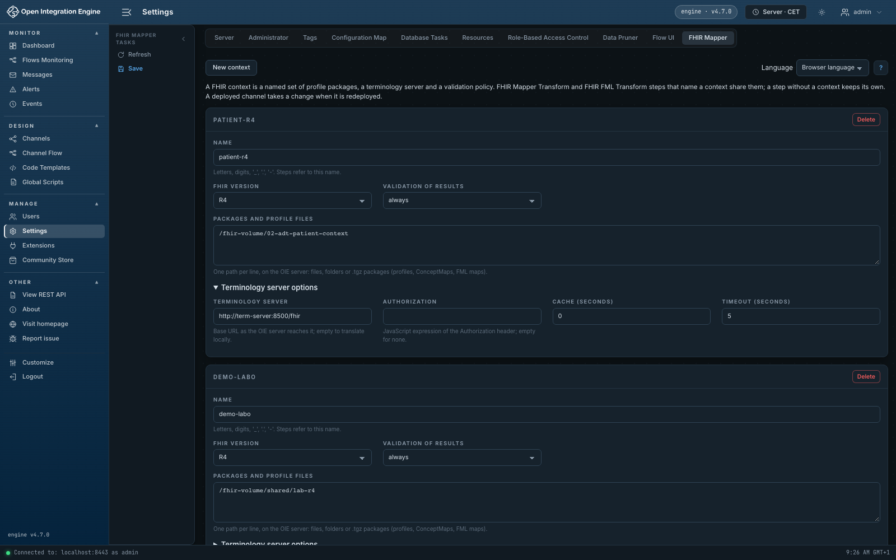
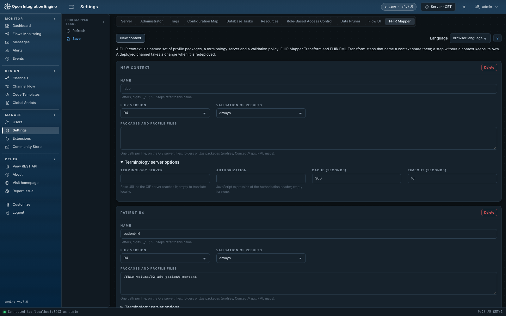
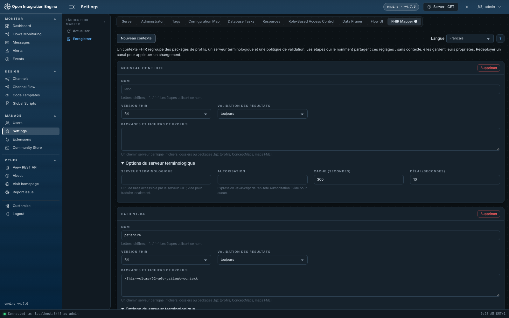

# Settings › FHIR Mapper

[Accueil du manuel](../README.md) · [Démarrage](../demarrage.md)

Le panneau **Settings › FHIR Mapper** administre les **contextes FHIR partagés** du serveur ainsi que la préférence de langue de l'interface. Un contexte regroupe sous un nom unique :

- la **version FHIR** (`R4`, `R4B` ou `R5`) ;
- la politique de **validation des résultats** (`always` ou `off`) ;
- la liste des **packages et fichiers de profils** sur le serveur (un chemin par ligne) ;
- les paramètres du **serveur de terminologie** distant (URL, expression `Authorization`, durée du cache et délai d'attente).

Toute étape **FHIR Mapper Transform** ou **FHIR FML Transform** qui sélectionne ce contexte hérite automatiquement de ses réglages, sans avoir à recopier les chemins de packages ou l'URL terminologique.

## Créer ou modifier un contexte FHIR

1. Dans le menu gauche de Web Admin, ouvrir **Settings**, puis l'onglet **FHIR Mapper**.
2. Cliquer sur **New context** en haut à droite pour ajouter un nouveau contexte en tête de liste, ou modifier directement un contexte existant.
3. Renseigner les champs du contexte :

| Champ | Description |
|---|---|
| **Name** | Identifiant unique du contexte (lettres, chiffres, `_`, `.`, `-`), par exemple `patient-r4` ou `fr-core-2.2.0`. |
| **FHIR version** | Version FHIR des ressources et définitions (`R4`, `R4B` ou `R5`). |
| **Validation of results** | `always` (valider systématiquement les ressources produites) ou `off` (désactiver la validation par défaut pour ce contexte). |
| **Packages and profile files** | Un chemin serveur par ligne : dossier de ressources JSON/XML/FML (`/fhir-volume/shared/lab-r4`), fichier individuel ou archive NPM d'Implementation Guide (`/fhir-packages/hl7.fhir.fr.core-2.2.0.tgz`). |
| **Terminology server** | URL de base d'un serveur terminologique FHIR (ex. `http://term-server:8500/fhir`). Laisser vide pour résoudre les traductions uniquement sur les `ConceptMap` locales des packages. |
| **Authorization** | Expression JavaScript évaluée au runtime pour construire l'en-tête HTTP `Authorization` (ex. `'Bearer ' + $cfg('TX_TOKEN')`). La valeur résolue n'est jamais exposée dans les traces. |
| **Cache (seconds)** | Durée de mise en cache des traductions terminologiques distantes (`300` s par défaut, `0` pour désactiver le cache). |
| **Timeout (seconds)** | Délai maximal d'attente HTTP pour le serveur de terminologie (`10` s par défaut). |

4. Cliquer sur **Save** dans le panneau latéral **FHIR Mapper Tasks** pour enregistrer la configuration sur le serveur (permission requise : `Manage FHIR mapper settings`).
5. **Redéployer** les canaux qui utilisent un contexte modifié afin qu'ils prennent en compte les nouveaux paramètres lors du traitement des messages.

> [!IMPORTANT]
> Les chemins saisis dans **Packages and profile files** sont résolus par le serveur OIE. Fournir explicitement les packages de dépendances directes requis par vos profils (comme `hl7.fhir.uv.extensions.r4`, `hl7.terminology.r4` et `ans.fr.terminologies` pour `hl7.fhir.fr.core`). Les contextes sont inclus dans la sauvegarde serveur native d'OIE (**Backup / Restore Config**).

## Choisir la langue et le thème

- **Langue du plugin** : en haut à droite de **Settings › FHIR Mapper**, le sélecteur **Language / Langue** propose *Browser language / Langue du navigateur* (défaut, avec repli sur l'anglais), *English* ou *Français*. Le changement s'applique immédiatement à tous les écrans du plugin dans le navigateur courant (`localStorage`).
- **Thème clair / sombre** : le plugin s'adapte automatiquement au thème de Web Admin (accessible via la palette de commandes ou le bouton de thème de Web Admin).

